# bbb-plugin-participant-stack

A plugin for the BigBlueButton 4.0 HTML5 client that keeps the people of the meeting in sight: a compact stack of avatars in the top bar that shows who is presenting, who raised a hand, who is reacting and who is waiting to join, without the user list or the chat being open.

It implements the idea in [bigbluebutton/bigbluebutton#25382](https://github.com/bigbluebutton/bigbluebutton/issues/25382).

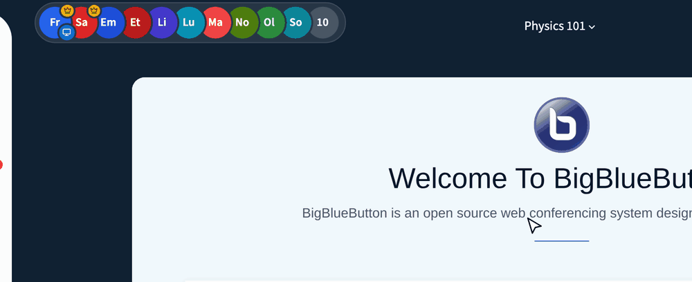

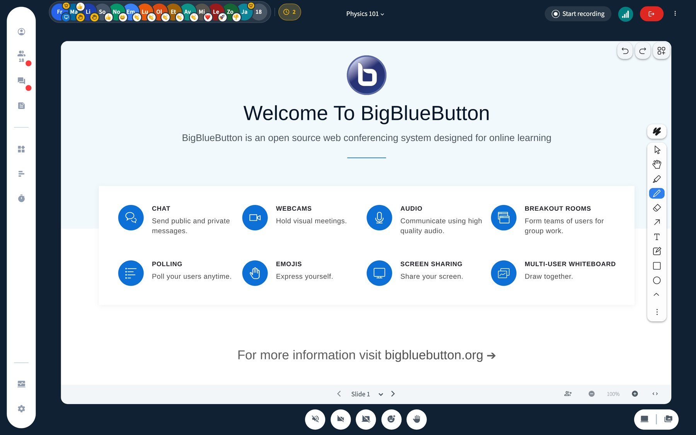

_Screenshots: default BigBlueButton 4.0 client, no theme._

## What it shows

In this order, for as long as there is room:

1. the presenter;
2. users with a raised hand, in the order they raised it;
3. users with an active reaction;
4. everyone else, moderators first;
5. a counter with the number of users in the meeting, which opens the list of everyone;
6. for moderators, a pill with the number of users in the waiting room.

Each avatar carries up to two marks. The lower corner takes a raised hand, else the reaction, else the presenter mark. The upper corner takes whatever comes next (a raised hand and a reaction show together), and otherwise a crown for moderators. A user's avatar image is used when they have one.

By default the stack is shown to moderators and the presenter. See [`visibleTo`](#settings).

## What you can do with it

**Read a name at once.** Hovering an avatar shows the name and status with no tooltip delay, so you can call on whoever raised a hand.

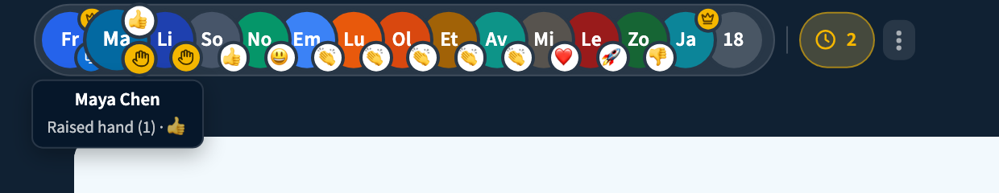

**Act on a user.** Clicking an avatar opens a menu. Moderators get: lower hand, lock or unlock, make presenter, promote or demote. Anyone can lower their own hand and remove their own reaction.

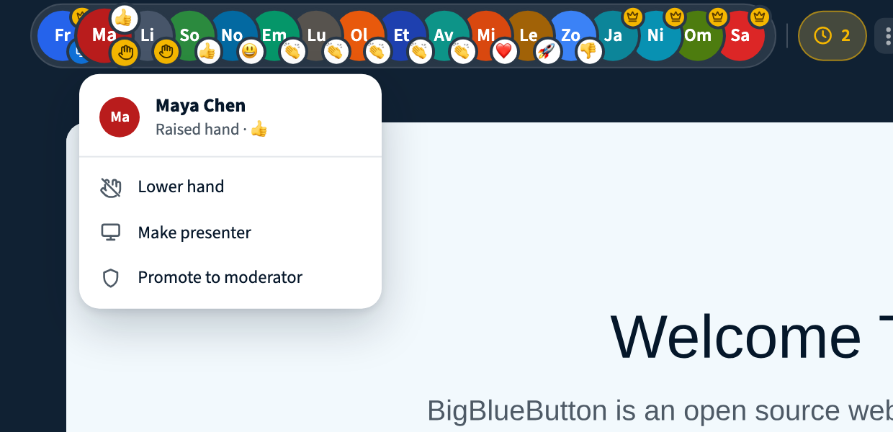

**Admit the waiting room.** The pill opens the list of waiting users: accept or deny one by one, or everyone.

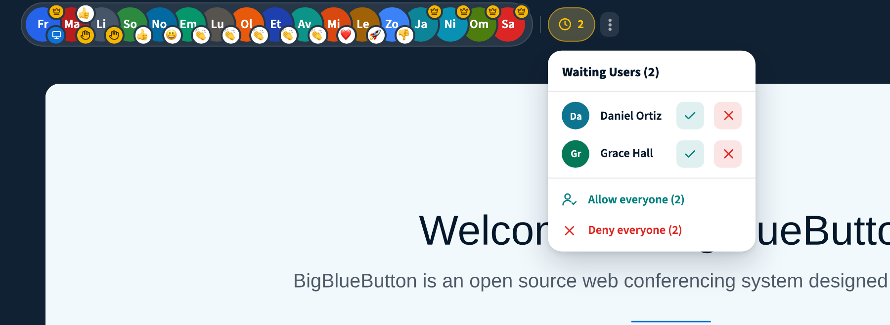

**See who is reacting.** Users with the same reaction are shown one by one while everyone with something going on fits. When they do not, they become one item with a count; its menu lists them and lets a moderator clear all reactions.

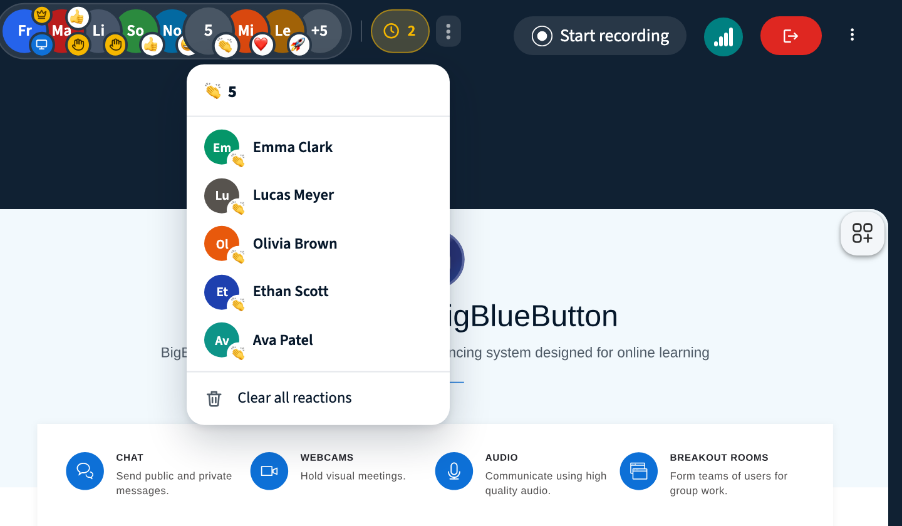

**See everyone.** The last item is the number of users in the meeting. It opens the list of everyone, in the order of the user list (presenter, moderators, then by name), and clicking a name opens that user's actions. To stay light in a large meeting, the list names the first page of the user list plus whoever has something going on, 50 at most, and closes with a `+X` for the others. With `counter: hidden` the item is a `+N` for the users that did not fit instead.

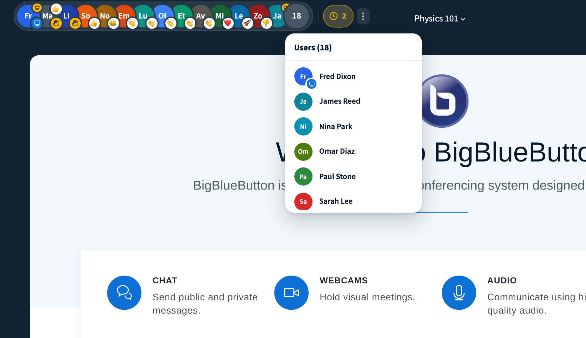

**Stay small, expand on demand.** At rest the stack keeps to the free room of the bar and to 15 items. When that leaves a raised hand, a reaction or the waiting room out of sight, the pointer on the stack expands it: the meeting title gives way and everything that fits is shown. Users with nothing going on stay in the list of the counter.

| At rest, with the chat open |
|---|
| 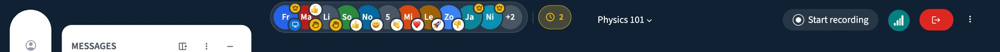 |

| With the pointer on it |
|---|
| 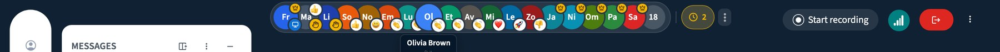 |

**Hide it or move it.** The `⋮` button, shown while the stack is expanded, lets each user pick a position or hide the stack. An entry in the client's options menu brings it back. The choice is remembered in the browser.

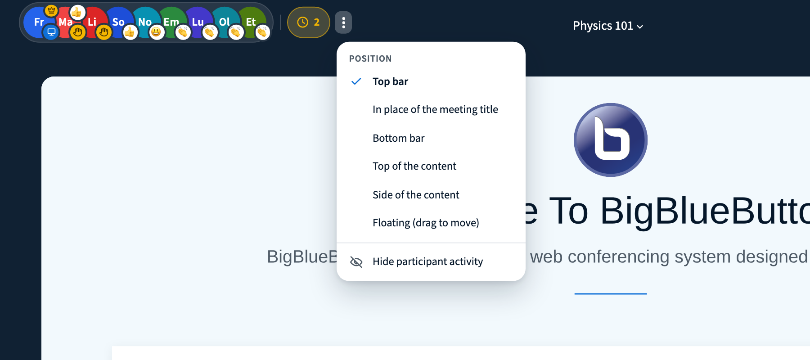

## Try it without installing

The plugin is hosted on GitHub Pages. Pass its manifest when you create a meeting, and that meeting loads the plugin with nothing installed on the server:

```text
pluginManifests=[{"url":"https://gustavotrott.github.io/bbb-plugin-participant-stack/manifest.json"}]
```

You can add it to the `create` call in [API Mate](https://mconf.github.io/api-mate/) or in your own integration. The BigBlueButton server reads the manifest when the meeting is created, so it must reach `github.io`. The participants' browsers load the plugin from there too.

Requires BigBlueButton 4.0 (plugin SDK `^1.0.0-beta.3`).

## Install on your server

These steps install from the latest [release](https://github.com/gustavotrott/bbb-plugin-participant-stack/releases/latest).

1. Download it into a folder served by nginx:

   ```bash
   sudo mkdir -p /var/www/bigbluebutton-default/assets/plugins/bbb-plugin-participant-stack
   curl -fsSL https://github.com/gustavotrott/bbb-plugin-participant-stack/releases/latest/download/bbb-plugin-participant-stack.tar.gz \
     | sudo tar xz --no-same-owner -C /var/www/bigbluebutton-default/assets/plugins/bbb-plugin-participant-stack
   ```

2. Add the manifest to `pluginManifests` in `/etc/bigbluebutton/bbb-web.properties`. Keep the other plugins you already have in the list:

   ```properties
   pluginManifests=[{"url":"https://<your-server>/plugins/bbb-plugin-participant-stack/manifest.json"}]
   ```

3. Restart bbb-web:

   ```bash
   sudo systemctl restart bbb-web
   ```

Meetings created from then on load the plugin. To update, run step 1 again. No restart is needed.

You can skip the download and put the GitHub Pages manifest in `bbb-web.properties` instead. The plugin then always follows the latest version on `main`.

## Where it sits

| In place of the meeting title (`navbar-center`) |
|---|
| 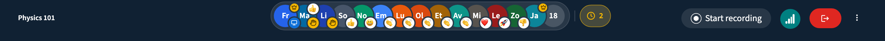 |

The SDK cannot dock plugin content in the client layout yet, so the stack is rendered in an SDK floating
window and docks itself next to the client's nav bar and actions bar, following them as panels open and close.

| `position` | Place |
|---|---|
| `navbar-left` (default) | Start of the top bar, before the meeting title |
| `navbar-center` | In place of the meeting title. The client's title is hidden with CSS and redrawn smaller at the start of the bar; clicking it still opens the session details |
| `actions-bar-left` | Start of the bottom bar |
| `media-top-left` | Over the content, right below the top bar, at the start |
| `media-top-center` | Over the content, right below the top bar, centered |
| `media-left` | Over the content, a vertical stack at the start |
| `floating` | A window the user drags around |

When a bar has less than 150px free, the stack moves to `media-top-left`. On phones the stack is off unless `showOnMobile` is set.

### At rest and expanded

At rest the stack keeps to the free room of its bar: the `⋮` button is not drawn (except on touch screens,
which have no hover to reveal it) and, when room is short, the waiting pill gives its place to avatars and
the counter gets a small clock badge instead.

With the pointer on the stack, keyboard focus inside it or one of its menus open, `⋮` appears. If the stack
is holding back something going on (a raised hand, a reaction, the waiting pill), it also expands: the
waiting pill appears, `maxVisible` no longer applies, and in `navbar-left` the stack may spread over the
meeting title, which is hidden until the pointer leaves. `expandOnHover` changes when it expands.

In the top bar the stack stays clear of the client's talking indicator, which sits right below: it moves up
as far as the bar allows and only then shrinks its avatars.

## Settings

All optional. Set them in `/etc/bigbluebutton/bbb-html5.yml`:

```yaml
public:
  plugins:
    - name: ParticipantStack
      settings:
        position: navbar-left
        design: overlap
        visibleTo: moderators-and-presenter
```

| Setting | Default | |
|---|---|---|
| `position` | `navbar-left` | See the table above |
| `positionWithPanelOpen` | unset | A different docked position while a sidebar panel (chat, notes, ...) is open and the bars are narrower. Ignored once the user picks their own position |
| `hideWhenUserListOpen` | `true` | Hides the stack while the user list is open, since the list shows the same hands, reactions and waiting users |
| `design` | `overlap` | `overlap`: avatars overlapping inside a pill. `spaced`: separate avatars. `summary`: one counter per kind of activity |
| `visibleTo` | `moderators-and-presenter` | `all`, `moderators`, `presenter` or `moderators-and-presenter`. Follows role changes during the meeting |
| `userCanHide` | `true` | Users can hide the stack from its `⋮` menu and bring it back from the client's options menu |
| `userCanMove` | `true` | Users can pick their own position from the `⋮` menu |
| `positions` | all but `media-top-left` | The positions offered to users, as a list or a comma-separated string |
| `expandOnHover` | `activity` | `activity`: expands only when a raised hand, a reaction or the waiting pill is out of sight. `always`: expands to every user that fits. `never` |
| `showOnMobile` | `false` | Shows the stack on phones (windows up to 640px wide) too |
| `counter` | `total` | The last item. `total`: the number of users in the meeting, opening the list of everyone. `hidden`: `+N`, the users that did not fit |
| `maxVisible` | `15` | Most items shown at rest, counter included. Fewer are shown when the bar runs out of room |
| `showIdleUsers` | `true` | Fills the remaining room with the users that have no hand raised and no reaction. `false` shows activity only |
| `groupReactionsFrom` | `3` | Users with the same reaction needed to group them, when there is no room to show them one by one |
| `showPresenter` | `true` | |

What a user chooses (hidden, position) is stored in their browser and kept for the next meetings.

To try settings without touching the server, set them in the browser console and reload:

```js
localStorage.setItem('bbb-plugin-participant-stack', '{"position":"navbar-center","design":"summary"}')
```

### Designs

| `design` | |
|---|---|
| `overlap` (default) | 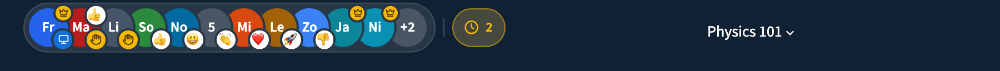 |
| `spaced` | 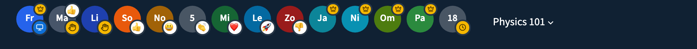 |
| `summary` |  |


## Data

What the plugin asks the server for was chosen to add as little load as possible:

| Data | Source | Extra per client |
|---|---|---|
| Presenter and users with nothing going on | The first page of the client's user list (`Patched_UserListSubscription`, same text and variables as the client) | One query limited to the page size (50 by default). None while the client's own user list is open |
| Number of users, for the counter | The client's `UsersCount` | None: the client always has it open |
| Raised hands | The client's `RaisedHandUsers` | None |
| Waiting users (moderators only) | The client's `getGuestWaitingUsers` | None |
| Reactions | A stream (`UserReactions`, same text as `bbb-plugin-reaction-stack`), starting 15 seconds back | One stream; each reaction is sent once |

The client keeps one live subscription per identical query and variables and shares it, and the server can
evaluate an identical query once for many users. That is why the queries in `src/graphql/queries.ts` are
copied from the client field for field, including fields the stack does not read. Edit them and they still
work, but stop being shared.

Consequences worth knowing:

- Users beyond the first page are known only by their number, unless they raise a hand or react. The counter's
  menu lists up to 50 of the ones it knows and closes with the count of the others.
- A reaction made more than 15 seconds before a user joined is not shown to that user.
- Nothing is subscribed to for users who do not see the stack (`visibleTo`, or hidden by the user).

## Languages

`public/locales` has a file for every language BigBlueButton ships that translates at least one of the
strings used here (61 at the time of writing). They are generated, not hand-written:

```bash
npm run build-locales            # reads ../bigbluebutton/bigbluebutton-html5/public/locales
node scripts/build-locales.js /path/to/bigbluebutton-html5/public/locales
```

Most strings are taken from the client's own, community-maintained translations. The few the client does
not have (the position names, hide/show, "Raised hand") are in `scripts/own-translations.js` for 28
languages; other languages show those in English. Corrections are welcome there.

## Theming

Colors come from the client's palette variables, and inside a bar the stack takes the bar's own background.
A theme can also set, on `:root`:

| Variable | Default | |
|---|---|---|
| `--participant-stack-radius` | `999px` | Pill and counters |
| `--participant-stack-avatar-radius` | `50%` | Avatars |
| `--participant-stack-popover-radius` | `1rem` | Menus |

Stable class names: `.bbb-participant-stack` (also `--overlap`/`--spaced`/`--summary` and `--<position>`),
`__list`, `__item` (`--user`, `--reactions`, `--hands`, `--overflow`), `__avatar`, `__badge`, `__waiting`,
`__more`, `__popover`, `__title`.

## Build from source

```bash
npm ci
npm run build-bundle
sudo mkdir -p /var/www/bigbluebutton-default/assets/plugins/bbb-plugin-participant-stack
sudo cp -r dist/* /var/www/bigbluebutton-default/assets/plugins/bbb-plugin-participant-stack/
```

`npm start` serves the plugin from source on port 4701, as described in the
[plugin SDK](https://github.com/bigbluebutton/bigbluebutton-html-plugin-sdk#running-the-plugin-from-source).

## Limits

- `navbar-center` and the docking in general read the client's DOM (`#Navbar`, `#ActionsBar`,
  `#presentationTitle`). If a client release renames them, the stack falls back to the start of the top bar
  or stays hidden; it does not break the client.
- A floating window dragged by the user goes back to its starting place in the next meeting.
- `media-top-left` and `media-left` share their corner with `bbb-plugin-reaction-stack`.

## License

[MIT](LICENSE)
